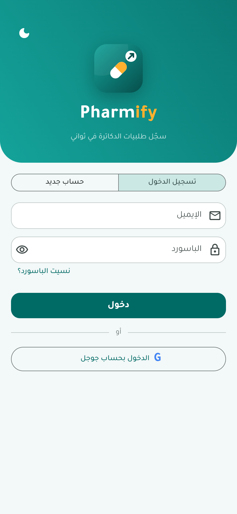
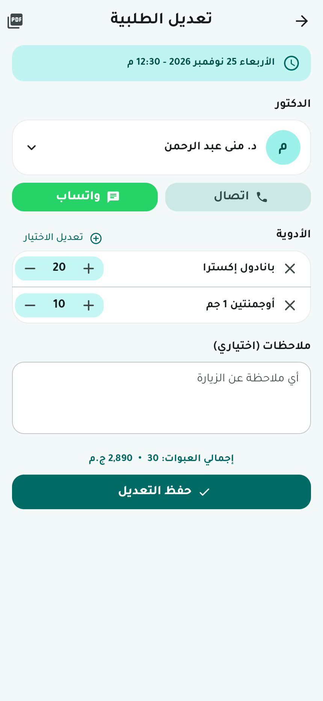
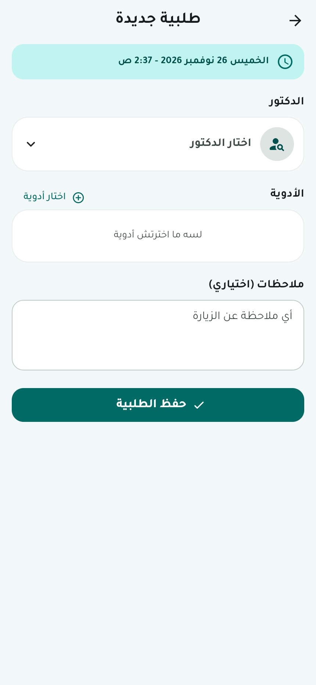
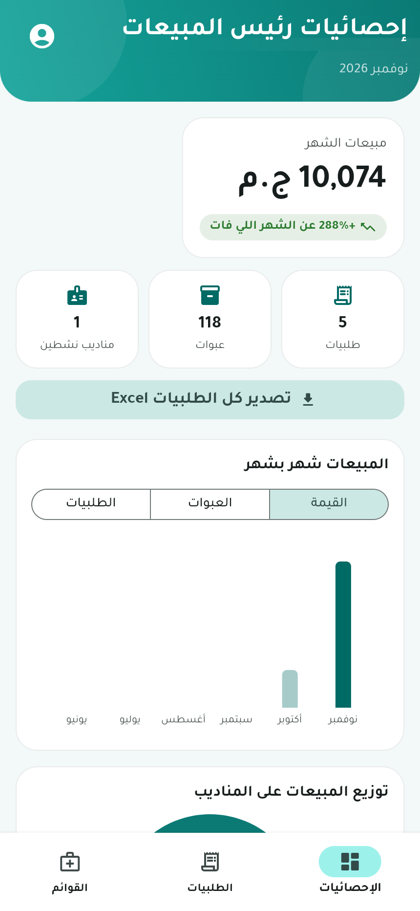
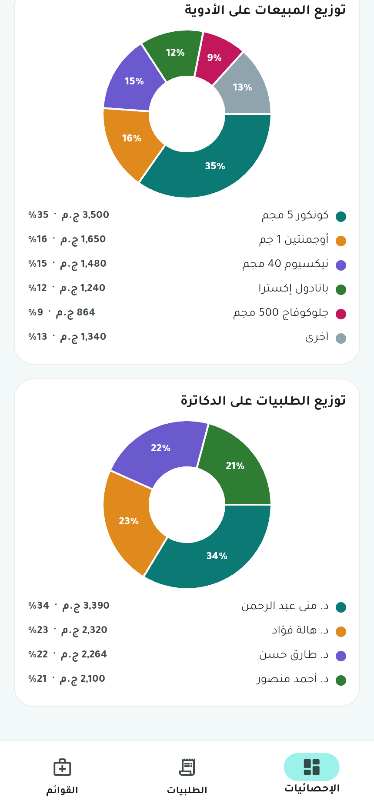

# Pharmify

Install on Android: open the [latest release](https://github.com/selenasameh31-ux/pharmify/releases/latest), download `pharmify.apk`, and allow installs from your browser when Android asks.

A Flutter app for pharmaceutical companies whose sales reps visit doctors: reps log visit orders on their phones, and sales managers track everything from an admin statistics screen.

Built by **Selena Sameh**.

## Features

**Rep app (mobile)**
- Bilingual interface: Arabic RTL by default, English LTR toggle, switchable in place without losing state
- Sign up / sign in (email + native Google account picker), offline-capable session restore
- Log a doctor-visit order in seconds: doctor, medicines, quantities, notes
- Live totals while picking medicines (packs + EGP)
- Doctors and medicines lists with add/edit/delete, filter-as-you-type search, WhatsApp and call deep links
- Duplicate protection: doctors deduplicated by phone number, with an Arabic-aware similar-name picker
- Diacritic-insensitive Arabic search (أ/إ/آ, ة/ه, ى/ي normalized)
- PDF invoice generation and sharing per order
- Weekly summary: visits, packs sold, top doctors and medicines
- Offline-first: orders queue locally and sync to Firestore when back online

**Admin statistics**
- All reps' orders live, ranked by packs sold
- Month-over-month sales chart (value / packs / orders) plus proportional donut charts: sales by rep, by medicine, and orders by doctor (top 5 + Others)
- One-tap Excel (xlsx) export of all orders, admin-only, generic column layout for any pharma company
- Doctor and medicine catalog management with one-time seed data; edit/delete controls hidden from non-admin reps

## Screenshots

<table width="100%">
<tr>
<th width="33%">Login</th>
<th width="33%">Sign up</th>
<th width="33%">Orders</th>
</tr>
<tr>
<td width="33%" valign="top"></td>
<td width="33%" valign="top"></td>
<td width="33%" valign="top"></td>
</tr>
<tr>
<th width="33%">Order details</th>
<th width="33%">New order</th>
<th width="33%">Lists + search</th>
</tr>
<tr>
<td width="33%" valign="top"></td>
<td width="33%" valign="top"></td>
<td width="33%" valign="top"></td>
</tr>
<tr>
<th width="33%">Statistics</th>
<th width="33%">Sales donuts</th>
<th width="33%">PDF invoice</th>
</tr>
<tr>
<td width="33%" valign="top"></td>
<td width="33%" valign="top"></td>
<td width="33%" valign="top"></td>
</tr>
</table>

## Security

Firestore security rules (`firestore.rules`) enforce the same roles the UI assumes, server-side:

- **Doctors and medicines** are shared catalogs: any signed-in user can read and add doctors, but only admins can edit or delete catalog entries; medicine writes are admin-only.
- **Orders** are private to their owner: a rep can create, read, update and delete only their own orders (`repId` is immutable), while admins have full access.
- **User roles** live in a `users` collection; an email allow-list (`kAdminEmails`) bootstraps the first admin so no manual console edits are needed.

The UI mirrors these rules (non-admin reps never see edit controls), but the rules are the real boundary: even a modified client cannot touch another rep's orders or the shared catalog.

## Tech stack

- **Flutter** (Material 3, dark mode) - one codebase for Android, iOS and web
- **Firebase Auth + Cloud Firestore** - authentication and realtime data with offline persistence
- **Clean Architecture** - feature-first folders (`features/auth`, `features/orders`, `features/doctors`, `features/medicines`, `features/catalog`, `features/statistics`, `features/home`), each split into `domain` (pure-Dart entities, repository contracts, use cases), `data` (models, Firebase/local datasources, repository implementations) and `presentation` (pages). Shared code lives in `core/` (DI, localization, theme, widgets, PDF utilities) and `app/` (app shell and store).
- **State management:** `ChangeNotifier` (no external framework)
- **PDF:** `pdf` + `printing` packages for invoices
- **Deep links:** WhatsApp `wa.me` links and `tel:` for doctor contacts

## Notes

- `google-services.json`, `local.properties` and keystores are intentionally excluded via `.gitignore`.
- Firestore document shapes are versioned (`doctors_v2`, `medicines_v2`, `orders_v2`) so existing installs keep working across updates.

## License

All rights reserved. The code is public so it can be read and reviewed, not reused. See [LICENSE](LICENSE).
